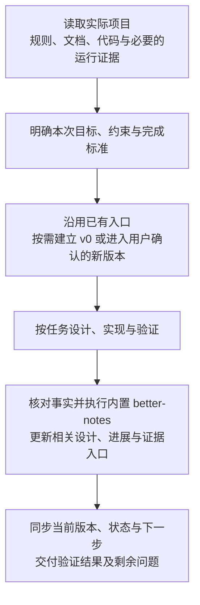

<a id="top"></a>

<div align="center">
  <h1>project-building</h1>

<strong>建立项目规则、按版本维护设计与进展，让协作者能接手并继续推进。</strong>

[使用方式](#使用方式) · [项目结构](#项目结构) · [工作流程](#工作流程) · [使用边界](#使用边界) · [规则与模板](#规则与模板)
</div>

`project-building` 是适用于软件开发和研究项目的 Agent Skill。它先读取实际项目，再按任务建立或维护 `AGENTS.md`、版本文档和项目交接，把设计、实现、验证结果与下一步关联起来。

文档从 `v0` 开始组织，后续随用户确认的设计迭代建立 `v1`、`v2`。文档编写必须执行内置 `better-notes`，核对来源、语言准确性和写作风格，无需另行安装该依赖。

## 使用方式

### 本地安装

在本仓库根目录执行，将 skill 复制到对应 Agent 的全局技能目录。选择需要的一种方式即可：

```bash
# Codex 或读取此目录的其他 Agent
mkdir -p ~/.agents/skills
cp -R project-building ~/.agents/skills/

# Claude Code
mkdir -p ~/.claude/skills
cp -R project-building ~/.claude/skills/
```

安装后新开会话。Agent 需要支持从技能目录读取 `SKILL.md` 及相对路径引用的资料。复制安装不会自动同步后续修改。

### 调用示例

**建立项目文档：**

> 使用 $project-building 读取当前项目，建立 AGENTS.md、项目交接和 docs/v0/ 文档。先核实实际代码、环境与命令，已有等价文件直接沿用。

**继续推进工作：**

> 使用 $project-building 接手当前项目，读取交接和当前版本设计，完成这次指定的功能与验证，并更新受影响的设计、进展和交接记录。

**进入下一轮设计：**

> 使用 $project-building，按我确认的新设计进入 v1。说明相对 v0 的变化，保留旧版记录，建立新版设计与进展入口，并同步当前工作版本。

**只整理交接：**

> 使用 $project-building 核实当前状态，整理 PROJECT_HANDOFF.md 和文档导航；标明已验证、未验证及下一步。

输入包括目标项目、此次任务，以及已有的设计和约束。交付包括任务范围内的改动、相关文档、验证结果和剩余问题；仅要求整理文档时，按该范围执行。

## 项目结构

下面展示已经开始 `v1` 迭代时的项目结构。初始化时只建立 `v0`，不提前创建未来版本目录。

```text
项目根目录/
├── README.md                  # 项目介绍、使用方法与入口
├── AGENTS.md                  # 环境、命令、代码约定与操作约束
├── PROJECT_HANDOFF.md         # 当前工作版本、状态、问题与下一步
├── docs/
│   ├── README.md              # 全局索引：各版本目标、状态与承接关系
│   ├── v0/                    # 初始设计与实现
│   │   ├── README.md          # 本版本总览、状态摘要与导航
│   │   ├── DESIGN.md          # 本版本有效设计、接口与实现映射
│   │   ├── PROGRESS.md        # 按日期记录进展、决定与验证结果
│   │   └── guides/            # 按需保存专题材料
│   │       ├── 操作指南.md
│   │       └── YYYY-MM-DD-方案探索.md
│   └── v1/                    # 用户确认的下一轮设计迭代
│       ├── README.md          # 本版本目标、相对 v0 的变化与导航
│       ├── DESIGN.md
│       ├── PROGRESS.md
│       └── guides/
├── src/                       # 项目代码，目录名按实际项目确定
├── tests/                     # 测试
├── configs/                   # 实际配置
└── outputs/                   # 结果、日志、图表、权重等实际产物
```

`src/`、`tests/`、`configs/`、`outputs/` 和专题文件名是示例，沿用项目实际结构。大型数据、日志和权重按项目的存储与 Git 忽略规则管理。多模块项目可采用 `docs/<模块>/v0/`；已有等价结构和版本号时沿用，不重编号或擅自搬迁。

### 文件分工

| 文件或目录 | 回答的问题 |
| --- | --- |
| 根 `AGENTS.md` | 在项目里如何工作？有哪些环境、命令和长期约束？ |
| 根 `PROJECT_HANDOFF.md` | 当前在哪个版本？做到哪里？下一步做什么？ |
| `docs/README.md` | 各版本是什么关系？当前版本和历史资料在哪里？ |
| 版本内 `README.md` | 这一版要做什么？从哪里开始阅读和使用？ |
| 版本内 `DESIGN.md` | 当前有效设计是什么？如何映射到代码？有哪些已知差异？ |
| 版本内 `PROGRESS.md` | 为什么改变方案？实际改了什么？验证结果是什么？ |
| 版本内 `guides/` | 哪些探索、审查、操作或分析需要单独展开？ |

### 版本如何递增

- 新项目从 `docs/v0/` 开始，目录统一使用小写 `v`。
- 用户确认下一轮设计迭代后建立 `v1`，随后依次递增。
- 当前方案内的修复、补充验证和日常进展更新当前版本，一次提交或一次实验不自动升版。
- 新版 README 说明相对上一版的目标和主要变化；新版 DESIGN 记录有效设计；新版 PROGRESS 从本轮迭代开始记录。
- 保留旧版本记录，链接前后版本，并更新全局索引与根交接文件。

同一版本内，先判断能否更新三个核心文件；需要单独展开的内容才放入 `guides/`。其中已采用的结论同步到 DESIGN 或 PROGRESS，原始结果和日志留在实际产物目录。

## 工作流程



文档按变化更新：命令和长期约束进入 AGENTS，设计和行为进入 DESIGN，重要决定和结果进入 PROGRESS，当前状态进入 HANDOFF，新增入口进入索引。

研究与长时间运行任务还需保存代码版本、配置、数据与抽样方式、种子、预算、运行入口和产物位置。检查进度时结合真实进程、日志与产物；比较结果前核对协议，并保留失败、缺失和否定结果的必要记录。

## 使用边界

- 讨论流程时交付方案；只读查询只汇报，不自动写文档。纯代码修改不因此加载全部写作资料。
- 已授权推进项目时，相关文档维护随工作执行；发布、推送、停止或重启作业仍依据本次任务的授权。
- 不为套用结构改技术栈、搬迁已有文件，或预建空目录和大量占位文档。
- 项目事实以实际代码、配置、测试、日志和产物为依据；涉及外部 API、依赖或技术结论时核对必要来源与版本。
- 用户指定的格式与项目有效约定优先。例如明确要求 Mermaid 时采用 Mermaid。
- 区分“已实现”“测试通过”“已部署”和“运行完成”；未执行的验证写清范围与原因。

## 规则与模板

| 入口 | 用途 |
| --- | --- |
| [SKILL.md](SKILL.md) | Agent 执行入口与完整规则 |
| [项目文档写作入口](references/document-writing.md) | 内置 better-notes 的加载规则及项目文档适配 |
| [AGENTS 编写指南](references/agents-guide.md) | 从项目事实提取具体操作约定 |
| [研究与长时间运行任务](references/research-projects.md) | 实验、部署、进度检查与结果解释规则 |
| [AGENTS 模板](assets/AGENTS.template.md) | 项目工作指南模板 |
| [交接模板](assets/HANDOFF.template.md) | 当前状态与后续工作模板 |
| [内置 better-notes](references/better-notes/SKILL.md) | 来源核对、语言准确性与内部编辑流程 |
| [副本来源清单](references/better-notes-source.json) | 快照来源、日期、文件哈希与更新策略 |

内置 better-notes 是独立快照，需手动比较、同步并重新核对完整性；不会自动跟随源目录更新。

资料核对日期：2026-10-27。本文依据本目录的规则、模板与内置参考资料编写。
